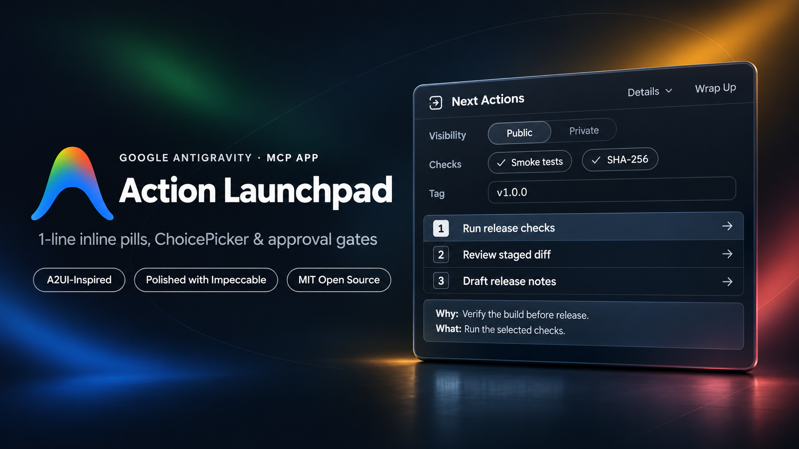
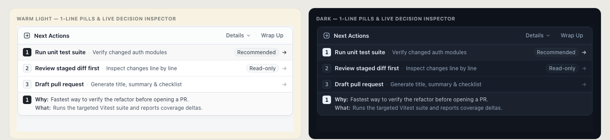
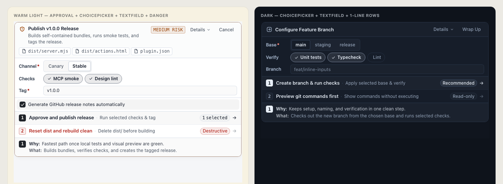

# Antigravity Action Launchpad (`antigravity-action-launchpad`)

[](https://glama.ai/mcp/servers/404kidwiz/antigravity-action-launchpad)



A lightweight, zero-framework **MCP App** plugin for Google Antigravity that renders native inline chat **Action Launchpad** cards (`deck_actions`) — ultra-compact 1-line follow-up pills, a zero-jump hover **Why / What** Decision Inspector, A2UI-inspired **ChoicePicker** chips, inline short text inputs, selectable checkboxes, and 2-step **Propose-Then-Apply** approval gates.

Works cross-platform (**macOS, Linux, and Windows**) with **Node.js 20+** and ships with self-contained prebuilt `dist/` bundles (zero runtime `node_modules` required for end users).





---

## Features

- **Ultra-compact 1-line command rows:** Edge-to-edge hairline-divided rows (`1`–`3` + quiet header ghost exit + flush `+N more options` overflow) with zero nested card chrome.
- **Zero-jump live Decision Inspector:** Hover or focus any row to crossfade its **`Why:`** and **`What:`** context in a fixed-height footer band (defaulting to the primary row — never resizes the iframe or flickers). Press `d` or click `Details ⌄` to expand all rows inline.
- **A2UI-inspired parameter trio (optional per card):**
  - `choices` — Single-select segmented controls (`role="radiogroup"`, arrow-key navigation, click-to-clear when optional) and softened multi-select filter chips (`aria-pressed` + animated checkmarks).
  - `inputs` — Lightweight short text fields (e.g., branch name, tag, release note) with `Enter` to advance/submit, `Esc` to blur, and `required` validation.
  - `toggles` — Selectable parameter checkboxes with live selected counts.
- **Propose-Then-Apply approval gates (`mode: "approval"`):** Risk badge (`low` / `medium` / `high`), affected `targets` pills, and inline 2-step arming confirmation on `tone: "danger"` actions (`Click to confirm` for `4.5s`, `Esc` cancels).
- **Host-adaptive Warm Light, Cool Light & Dark parity:** Inherits Antigravity host CSS variables with `light-dark()` fallbacks, `>= 12px` typography floor, and WCAG AA+ contrast across all themes.

---

## Quick Install

### Option A — 1-Paste Agent Setup (Recommended — zero manual config)

Copy and paste this prompt directly into **Google Antigravity**. Your agent will install the plugin and ask just **2 quick questions** — letting you start with a **super slimmed-down** setup or unlock the **full** deck (and switch anytime):

```text
Install and configure the Antigravity Action Launchpad plugin for me from https://github.com/404kidwiz/antigravity-action-launchpad:

1. Clone https://github.com/404kidwiz/antigravity-action-launchpad.git into ~/.gemini/config/plugins/antigravity-action-launchpad (if it already exists, pull latest main) and verify Node.js 20+ is available.
2. Ask me just 2 quick multiple-choice questions so it fits how I work without being too much all at once:
   - Question 1 (Mode): Start slimmed down or unlock the full deck?
     • Slim (Recommended to start) — Super clean 1-line suggestion pills + hover Why/What inspector only (no chips, inputs, or extra controls)
     • Full — Full Action Launchpad: 1-line pills plus ChoicePicker chips, inline short text inputs, checkboxes, and 2-step approval gates when relevant
   - Question 2 (Frequency): How often should it appear?
     • Balanced (Recommended) — After completed tasks & key decision points; skip quick Q&A
     • Minimal — Only before high-stakes actions or multi-option choices
     • Proactive — On almost every substantive turn so I rarely have to type follow-ups
3. Tailor ~/.gemini/config/plugins/antigravity-action-launchpad/rules/AGENTS.md to my 2 choices (noting I can ask to switch between Slim and Full anytime), link me to Customizations to enable the plugin if needed, and show a quick live preview card matching my preset.
```

### Option B — Manual drop-in (no `npm install` needed)

Clone or download this repository directly into your Antigravity plugins directory:

```bash
git clone https://github.com/404kidwiz/antigravity-action-launchpad.git ~/.gemini/config/plugins/antigravity-action-launchpad
```

Then enable **Antigravity Action Launchpad** in Antigravity's **Customizations / Plugins** page (requires Node.js 20+ on `PATH`).

### Option C — Build from source

```bash
pnpm install
pnpm build   # Bundles self-contained dist/server.mjs and dist/actions.html
pnpm test    # Runs MCP stdio smoke tests
```

---

## Keyboard Shortcuts

| Key | Action |
|---|---|
| `1` – `9` | Trigger the matching action row (auto-expands overflow; `danger` rows still arm first) |
| `↑` / `↓` / `Home` / `End` | Rove focus across command rows and update the Decision Inspector |
| `←` / `→` | Switch options inside a single-select ChoicePicker segmented control |
| `d` | Toggle Expand-All (`Details ⌄` / `Compact`) |
| `Enter` | Commit primary action from card/checkboxes, or advance/commit from a text input |
| `Escape` | Disarm destructive action, collapse overflow, collapse `Details`, or blur text input |

---

## Tool Schema (`deck_actions`)

Every section outside `actions` is optional and omitted from the card unless passed for that turn:

```ts
{
  mode?: "pills" | "approval",         // default: "pills"
  heading?: string,                    // concise card title
  summary?: string,                    // optional context (primarily approval mode)
  risk?: "low" | "medium" | "high",    // approval risk badge
  targets?: string[],                  // affected files/services (approval mode)
  choices?: Array<{                    // A2UI-inspired ChoicePicker chip groups
    id: string,
    label: string,
    multiple?: boolean,                // false = segmented track, true = multi-select chips
    required?: boolean,
    options: Array<{ value: string, label: string }>,
    selected?: string[],
  }>,
  inputs?: Array<{                     // lightweight short text inputs (never for secrets)
    id: string,
    label: string,
    placeholder?: string,
    value?: string,
    required?: boolean,
    maxLength?: number,                // 1..500, default 200
  }>,
  toggles?: Array<{                    // selectable option checkboxes
    id: string,
    label: string,
    checked?: boolean,
  }>,
  actions: Array<{
    id: string,
    label: string,                     // crisp 3–5 word title
    sublabel?: string,                 // short muted inline scope cue
    badge?: string,                    // optional quiet trust/context tag
    prompt: string,                    // follow-up message sent on click
    tone?: "primary" | "neutral" | "ghost" | "danger",
    hint?: string,                     // "What" it does (hover inspector + Details)
    why?: string,                      // "Why" pick it (hover inspector + Details)
    spawnNew?: boolean,                // open follow-up in a new thread
    appliesToggles?: boolean,          // attach choices/inputs/toggles (default: primary)
    requireToggles?: boolean,
  }>
}
```

---

## Architecture

- [`src/server.ts`](src/server.ts) — Stdio MCP server (`@modelcontextprotocol/sdk` + `@modelcontextprotocol/ext-apps`) exposing `deck_actions` and `ui://antigravity-action-launchpad/actions.html` with input/choice/action sanitization.
- [`src/ui/actions.ts`](src/ui/actions.ts) + [`src/ui/shared.ts`](src/ui/shared.ts) + [`src/ui/shared.css`](src/ui/shared.css) — Zero-framework vanilla TypeScript MCP App bundled into a single self-contained `dist/actions.html`.
- [`rules/AGENTS.md`](rules/AGENTS.md) — Plugin instructions teaching agents when to emit `deck_actions` and how to anchor cards cleanly at the bottom of replies.
- [`DESIGN.md`](DESIGN.md) — Surface tokens, contrast rules, and interaction contract.

## License

[MIT](LICENSE)
